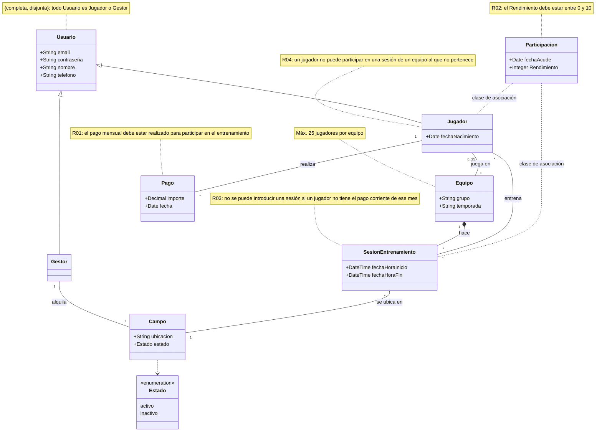
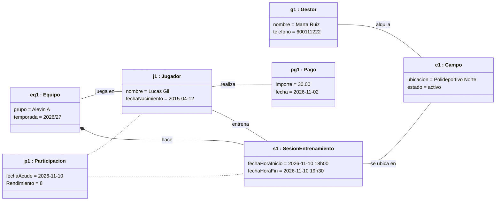
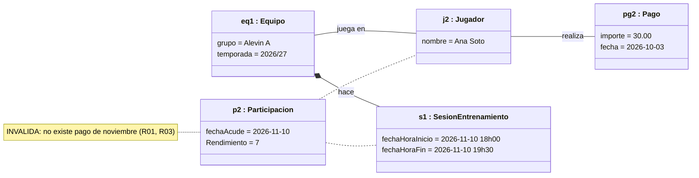
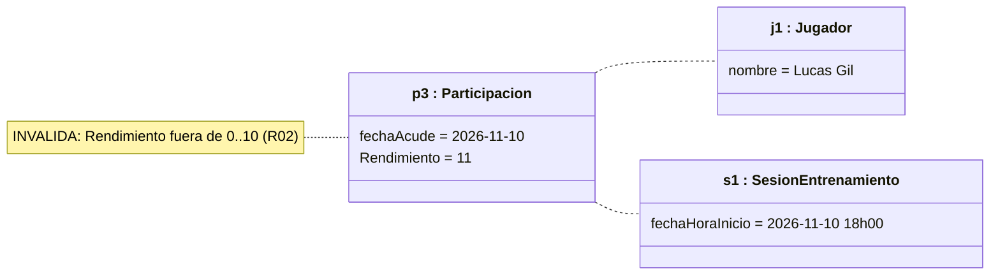
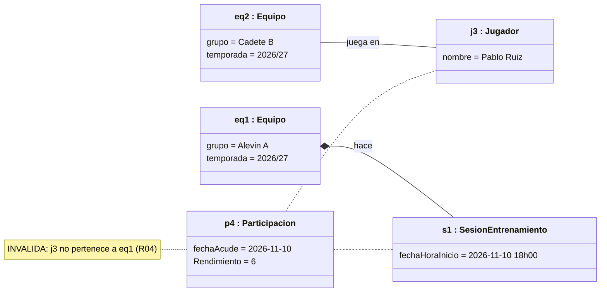
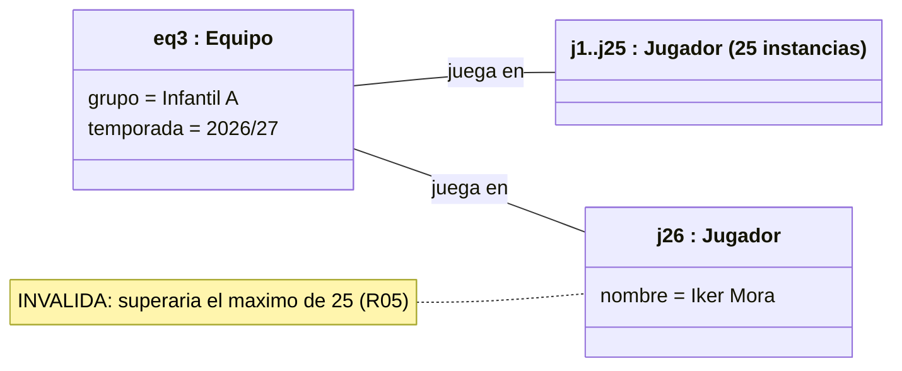

# ACADEMIA DE FÚTBOL "Gol & Formación"
 
## Miembros del grupo L6-DF-8 

1. Urbano Castro, Ignacio
2. Lorenzo Raposo, Daniel
3. Romero Gómez, Rafael
4. Camargo Moral, Julian

## 1. Introducción al problema

La Academia de Fútbol "Gol & Formación" ha experimentado un crecimiento en su volumen de alumnos durante los últimos años. Lo que comenzó como una pequeña escuela y equipo local ha evolucionado hasta convertirse en un reconocido club deportivo. En la actualidad, la institución centra su actividad exclusivamente en la vertiente formativa y deportiva.

Gestión Deportiva y Académica: Coordinación de equipos federados y de escuela en distintas categorías de edad (desde Prebenjamín hasta Juvenil), supervisión del cuerpo técnico, planificación de   sesiones de entrenamiento en pistas específicas y control de cuotas mensuales de los alumnos. 

## 2. Glosario de términos

Los términos específicos empleados en el dominio del problema son los siguientes:

* **Campo:** Instalación deportiva que el Gestor alquila para la realización de entrenamientos. El modelo conceptual solo recoge sus atributos ubicación y estado, su estado puede ser activo o inactivo.

* **Equipo:** Grupo deportivo identificado por `grupo` y `temporada`. Un equipo puede tener hasta 25 jugadores.
  
* **Gestor:** Perfil derivado de Usuario.

* **Jugador:** Perfil derivado de Usuario, con el atributo propio de 'fechaNacimiento' y atributos derivados de usurio. Realiza pagos, juega en equipos, asiste a sesiones de entrenamiento.

* **Pago:** Registro asociado a un Jugador que recoge `importe` y `fecha`. El pago mensual debe estar realizado para que el jugador participe en el entrenamiento.

* **Participación:** Clase de asociación entre Jugador y SesionEntrenamiento que registra `fechaAcude` y `Rendimiento`. El rendimiento debe estar entre 0 y 10.

* **SesionEntrenamiento:** Sesión con `fechaHoraInicio` y `fechaHoraFin`, relacionada con un equipo ,con las participaciones de los jugadores y se realiza en un campo.

* **Usuario:** Clase base con los atributos `email` ,`contraseña` , `nombre` y `telefono`. La especialización en Jugador y Gestor es completa y disjunta: todo Usuario pertenece a uno de esos dos tipos.

## 3. Visión general del sistema

### 3.1. Requisitos generales

El sistema de gestión de la academia de fútbol administra usuarios, equipos, entrenamientos, pagos y campos deportivos. El modelo conceptual establece las siguientes relaciones y restricciones:

* **Gestión de usuarios:** Usuario se especializa en Jugador y Gestor mediante una jerarquía completa y disjunta. Ambos perfiles comparten las credenciales `email` y `contraseña`.

* **Control de pagos:** Cada Pago registra el `importe` y la `fecha`, y está asociado a un Jugador. El pago mensual debe estar realizado para que el jugador participe en los entrenamientos.

* **Gestión de equipos:** Equipo se identifica mediante `grupo` y `temporada`. Los jugadores juegan en equipos y cada equipo tiene un máximo de 25 jugadores.

* **Gestión de entrenamientos:** Las sesiones registran `fechaHoraInicio` y `fechaHoraFin`. La participación de cada jugador en una sesión se registra mediante la clase de asociación Participación, con `fechaAcude` y `Rendimiento`.

* **Gestión de campos:** El Gestor alquila los campos deportivos.

* **Evaluación deportiva:** El rendimiento de cada jugador en una sesión debe estar entre 0 y 10.

### 3.2. Usuarios del sistema

El sistema distingue dos tipos de usuarios: Jugador y Gestor. Ambos heredan de Usuario, que almacena `email` y `contraseña`. La especialización es completa y disjunta, por lo que todo Usuario pertenece a uno de esos perfiles.

| **Tipo de actor** | **Rol / perfil** | **Descripción** |
| :--- | :--- | :--- |
| **Jugador** | Alumno de la academia | Tiene los atributos `nombre`, `fechaNacimiento` y `telefono`. Realiza pagos, juega en equipos y participa en sesiones de entrenamiento. |
| **Gestor** | Responsable administrativo | Tiene los atributos `nombre` y `telefono`. Se encarga de alquilar campos y gestionar la actividad de la academia. |

## 4. Catálogo de requisitos

### 4.1. Requisitos funcionales

### R.F.01. Registrar los pagos de un jugador

**Como** Gestor

**Quiero** registrar el importe y la fecha de los pagos de cada jugador

**Para** controlar el abono mensual de la academia.

**Prueba de aceptación**

* Registrar para cada Pago el `importe` y la `fecha`.
* Asociar cada pago con el Jugador correspondiente.
* Comprobar que el jugador ha realizado el pago mensual antes de permitirle participar en el entrenamiento.

---

### R.F.02. Gestionar los equipos y sus jugadores

**Como** Gestor

**Quiero** gestionar los equipos por grupo y temporada

**Para** organizar a los jugadores de la academia.

**Prueba de aceptación**

* Registrar el `grupo` y la `temporada` de cada Equipo.
* Asociar los jugadores con sus equipos.
* Comprobar que un equipo no supere el máximo de 25 jugadores.

---

### R.F.03. Registrar sesiones y participaciones

**Como** Gestor

**Quiero** registrar las sesiones de entrenamiento y la participación de cada jugador

**Para** llevar el control de la asistencia y del rendimiento deportivo.

**Prueba de aceptación**

* Registrar para cada sesión la `fechaHoraInicio` y la `fechaHoraFin`.
* Asociar las sesiones con los equipos correspondientes.
* Registrar la participación de cada Jugador en cada sesión mediante la clase de asociación Participación.
* Guardar en cada Participación la `fechaAcude` y el `Rendimiento`.
* Validar que el `Rendimiento` esté entre 0 y 10.
* Comprobar que el jugador haya realizado el pago mensual antes de participar.

---

### R.F.04. Alquilar campos deportivos

**Como** Gestor

**Quiero** alquilar campos deportivos

**Para** disponer de instalaciones para la actividad de la academia.

**Prueba de aceptación**

* Asociar los campos alquilados con el Gestor.
* Registrar y consultar los tres atributos del Campo (`Item 1`, `Item 2` e `Item 3`), cuyos nombres aparecen así en el modelo conceptual.

---

## 4.1.1. Requisitos de información

#### R.I.01. Datos de usuario

**Como** Gestor

**Quiero** guardar las credenciales de los usuarios

**Para** que puedan identificarse en el sistema.

**Prueba de aceptación**

* Guardar el `email` y la `contraseña` de cada Usuario.
* Comprobar que Usuario se especializa en Jugador y Gestor mediante una jerarquía completa y disjunta.

---

#### R.I.02. Datos del jugador

**Como** Gestor

**Quiero** guardar los datos de los jugadores

**Para** gestionar su participación en la academia.

**Prueba de aceptación**

* Guardar el `nombre`, la `fechaNacimiento` y el `telefono`.
* Incluir las credenciales heredadas de Usuario.
* Asociar al jugador con sus pagos, equipos y participaciones en sesiones.

---

#### R.I.03. Datos del gestor

**Como** Gestor

**Quiero** guardar mis datos de perfil

**Para** realizar las gestiones de la academia.

**Prueba de aceptación**

* Guardar el `nombre` y el `telefono`.
* Incluir las credenciales heredadas de Usuario.
* Asociar al Gestor con los campos que alquila.

---

#### R.I.04. Datos del equipo

**Como** Gestor

**Quiero** guardar la información de los equipos

**Para** organizarlos por grupo y temporada.

**Prueba de aceptación**

* Guardar el `grupo` y la `temporada`.
* Asociar el Equipo con sus jugadores.
* Respetar el máximo de 25 jugadores por equipo.

---

#### R.I.05. Datos de la sesión de entrenamiento

**Como** Gestor

**Quiero** guardar los datos de las sesiones

**Para** organizar los entrenamientos de los equipos.

**Prueba de aceptación**

* Guardar `fechaHoraInicio` y `fechaHoraFin`.
* Asociar las sesiones con los equipos.
* Registrar las participaciones de los jugadores en cada sesión.

---

#### R.I.08. Datos de participación y rendimiento

**Como** Gestor

**Quiero** guardar la asistencia y el rendimiento de cada jugador en las sesiones

**Para** consultar su actividad deportiva.

**Prueba de aceptación**

* Guardar `fechaAcude` y `Rendimiento` en la clase de asociación Participación.
* Asociar cada Participación con un Jugador y una SesionEntrenamiento.
* Validar que `Rendimiento` esté entre 0 y 10.

---

#### R.I.09. Datos del pago

**Como** Gestor

**Quiero** guardar los datos de los pagos de los jugadores

**Para** controlar el abono mensual.

**Prueba de aceptación**

* Guardar `importe` y `fecha`.
* Asociar cada Pago con el Jugador correspondiente.
* Comprobar que el pago mensual esté realizado antes de la participación del jugador en el entrenamiento.

---

#### R.I.10. Datos del campo

**Como** Gestor

**Quiero** guardar los datos de los campos deportivos

**Para** gestionar su alquiler.

**Prueba de aceptación**

* Asociar cada Campo con el Gestor que lo alquila.
* Registrar y consultar los atributos `Item 1`, `Item 2` e `Item 3`, tal como aparecen en el modelo conceptual.

---

### 4.1.2. Reglas de negocio

#### R.N.01. Pago mensual para participar

El pago mensual debe estar realizado para que un Jugador participe en el entrenamiento.

#### R.N.02. Rango del rendimiento

El valor de `Rendimiento` registrado en una Participación debe estar entre 0 y 10.

#### R.N.03. Pago corriente

No se puede introducir una sesión de entrenamiento si el jugador no tiene el pago corriente de ese mes

#### R.N.04. Participación en Sesion de Entrenamiento

Un jugador no puede participar en una sesión de entrenamiento a la que no pertenece

---

## 4.2. Mapa de historias de usuario

| ID Historia | Rol / Actor | Servicio / Acción | Requisito relacionado | Regla de negocio |
| :--- | :--- | :--- | :--- | :--- |
| **HU-01** | Gestor | Registrar y consultar los pagos de los jugadores | R.F.01, R.I.09 | R.N.01 |
| **HU-02** | Gestor | Organizar equipos y asignarles jugadores por grupo y temporada (máximo 25 por equipo) | R.F.02, R.I.04 | - |
| **HU-03** | Gestor | Registrar sesiones de entrenamiento asociadas a un equipo y a un campo | R.F.03, R.I.05 | R.N.03 |
| **HU-04** | Gestor | Registrar la asistencia y el rendimiento de cada jugador en las sesiones | R.F.03, R.I.08 | R.N.01, R.N.02, R.N.04 |
| **HU-05** | Gestor | Alquilar y gestionar los campos deportivos | R.F.04, R.I.10 | - |
| **HU-06** | Gestor | Gestionar los datos de los usuarios (jugadores y gestor) y sus credenciales | R.I.01, R.I.02, R.I.03 | - |

## 4.3. Requisitos no funcionales (opcional)

### R.N.F. 01. Guardar contraseñas de forma segura
Como Jugador / Gestor quiero que mi clave se guarde encriptada en la base de datos para que nadie pueda robármela.

### R.N.F. 02. Control automático de fallos en los datos
Como Gestor quiero que el sistema me avise o me bloquee si pongo mal una nota o un contrato para no guardar datos incorrectos por descuido.

-- fin entregable 1 --

## 5. Modelo conceptual

### 5.1. Diagrama de clases UML

> `Participacion` es la clase de asociación entre `Jugador` y `SesionEntrenamiento` (Mermaid no soporta clases de asociación de forma nativa, por eso se representa con dos líneas discontinuas).

#### Restricciones del modelo

| ID | Contexto | Restricción (lenguaje natural) | Restricción (OCL) |
|----|----------|--------------------------------|-------------------|
| R01 | `Participacion` | El jugador debe tener realizado el pago del mes en el que acude a la sesión. | `context Participacion inv R01: self.jugador.pago->exists(p \| p.fecha.month() = self.fechaAcude.month() and p.fecha.year() = self.fechaAcude.year())` |
| R02 | `Participacion` | El rendimiento debe estar entre 0 y 10. | `context Participacion inv R02: self.Rendimiento >= 0 and self.Rendimiento <= 10` |
| R03 | `SesionEntrenamiento` | No se puede introducir una sesión si algún jugador no tiene el pago corriente de ese mes. | `context SesionEntrenamiento inv R03: self.participacion->forAll(pa \| pa.jugador.pago->exists(p \| p.fecha.month() = self.fechaHoraInicio.month() and p.fecha.year() = self.fechaHoraInicio.year()))` |
| R04 | `Participacion` | Un jugador solo puede participar en sesiones de equipos a los que pertenece. | `context Participacion inv R04: self.sesionEntrenamiento.equipo.jugador->includes(self.jugador)` |
| R05 | `Equipo` | Un equipo no puede tener más de 25 jugadores. | `context Equipo inv R05: self.jugador->size() <= 25` |
| R06 | `Equipo` | Un equipo se identifica por la pareja (grupo, temporada). | `context Equipo inv R06: Equipo.allInstances()->isUnique(e \| Tuple{g = e.grupo, t = e.temporada})` |
| R07 | `Usuario` | La especialización en Jugador y Gestor es completa y disjunta. | `{complete, disjoint}` |
| R08 | `SesionEntrenamiento` | La sesión debe terminar después de empezar (restricción complementaria). | `context SesionEntrenamiento inv R08: self.fechaHoraFin > self.fechaHoraInicio` |

---

### 5.2. Escenarios de prueba

#### Escenario 1: Participación válida (caso correcto)

**Descripción:** el gestor Marta alquila el campo "Polideportivo Norte" (activo). El jugador Lucas pertenece al equipo Alevín A y pagó en noviembre. Se registra una sesión del equipo en ese campo y Lucas participa con un rendimiento de 8.

- **Precondiciones:** Lucas pertenece a Alevín A y tiene un pago con fecha de noviembre de 2026.
- **Acción:** registrar la sesión del 10/11/2026 y la participación de Lucas.
- **Resultado esperado:** operación aceptada, se cumplen R01–R05.

#### Escenario 2: Jugador sin pago del mes (viola R01 y R03)

**Descripción:** la jugadora Ana solo tiene un pago de octubre y se intenta registrar su participación en una sesión de noviembre.

- **Precondiciones:** Ana pertenece a Alevín A; su último pago es del 03/10/2026.
- **Acción:** registrar la sesión del 10/11/2026 con la participación de Ana.
- **Resultado esperado:** operación **rechazada** (R01 y R03).

#### Escenario 3: Rendimiento fuera de rango (viola R02)

**Descripción:** se intenta guardar un rendimiento de 11 para Lucas.

- **Precondiciones:** Lucas pertenece al equipo y tiene el pago de noviembre.
- **Acción:** registrar la participación con `Rendimiento = 11`.
- **Resultado esperado:** operación **rechazada** (R02). Con valores como 0, 5 o 10 se aceptaría.

#### Escenario 4: Jugador de otro equipo (viola R04)

**Descripción:** Pablo pertenece al equipo Cadete B, pero se intenta registrar su participación en una sesión de Alevín A.

- **Precondiciones:** Pablo tiene el pago de noviembre pero no pertenece a Alevín A.
- **Acción:** registrar la participación de Pablo en la sesión `s1`.
- **Resultado esperado:** operación **rechazada** (R04).

#### Escenario 5: Equipo completo (viola el máximo de 25 jugadores)

**Descripción:** el equipo Infantil A ya tiene 25 jugadores y se intenta asignar un jugador número 26.

- **Precondiciones:** `eq3` tiene 25 jugadores asociados.
- **Acción:** asociar al jugador `j26` con `eq3`.
- **Resultado esperado:** operación **rechazada** (R05).

---

## 6. Matrices de trazabilidad

Matriz entre los elementos del modelo conceptual y los requisitos. Por legibilidad se divide en tres tablas (entidades, asociaciones y restricciones) con las mismas filas.

> Los requisitos de información están numerados RI-01…RI-05, RI-08, RI-09 y RI-10, tal como aparecen en el catálogo.

### 6.1. Requisitos vs. entidades

| | Usuario | Jugador | Gestor | Equipo | Pago | SesionEntrenamiento | Participación | Campo | Estado |
|---|:-:|:-:|:-:|:-:|:-:|:-:|:-:|:-:|:-:|
| **RF-01** | | X | | | X | | | | |
| **RF-02** | | X | | X | | | | | |
| **RF-03** | | X | | X | X | X | X | X | |
| **RF-04** | | | X | | | | | X | X |
| **RI-01** | X | X | X | | | | | | |
| **RI-02** | X | X | | X | X | X | X | | |
| **RI-03** | X | | X | | | | | X | |
| **RI-04** | | X | | X | | | | | |
| **RI-05** | | X | | X | | X | X | X | |
| **RI-08** | | X | | | | X | X | | |
| **RI-09** | | X | | | X | | | | |
| **RI-10** | | | X | | | | | X | X |
| **RN-01** | | X | | | X | X | X | | |
| **RN-02** | | | | | | | X | | |
| **RN-03** | | X | | | X | X | | | |
| **RN-04** | | X | | X | | X | X | | |
| **RNF-01** | X | | | | | | | | |
| **RNF-02** | | | | X | | | X | | |

### 6.2. Requisitos vs. asociaciones

| | Generalización Usuario | realiza (Jugador–Pago) | juega en (Jugador–Equipo) | hace (Equipo–Sesión) | entrena (Jugador–Sesión) | alquila (Gestor–Campo) | se ubica en (Sesión–Campo) |
|---|:-:|:-:|:-:|:-:|:-:|:-:|:-:|
| **RF-01** | | X | | | | | |
| **RF-02** | | | X | | | | |
| **RF-03** | | X | X | X | X | | X |
| **RF-04** | | | | | | X | |
| **RI-01** | X | | | | | | |
| **RI-02** | X | X | X | | X | | |
| **RI-03** | X | | | | | X | |
| **RI-04** | | | X | | | | |
| **RI-05** | | | | X | X | | X |
| **RI-08** | | | | | X | | |
| **RI-09** | | X | | | | | |
| **RI-10** | | | | | | X | |
| **RN-01** | | X | | | X | | |
| **RN-02** | | | | | X | | |
| **RN-03** | | X | | | X | | |
| **RN-04** | | | X | X | X | | |
| **RNF-01** | | | | | | | |
| **RNF-02** | | | | | | | |

### 6.3. Requisitos vs. restricciones

| | R01 Pago mensual | R02 Rango rendimiento | R03 Pago corriente | R04 Pertenencia al equipo | R05 Máx. 25 jugadores | R07 Completa y disjunta |
|---|:-:|:-:|:-:|:-:|:-:|:-:|
| **RF-01** | X | | | | | |
| **RF-02** | | | | | X | |
| **RF-03** | X | X | X | X | | |
| **RF-04** | | | | | | |
| **RI-01** | | | | | | X |
| **RI-02** | | | | | | |
| **RI-03** | | | | | | |
| **RI-04** | | | | | X | |
| **RI-05** | | | X | | | |
| **RI-08** | X | X | | X | | |
| **RI-09** | X | | | | | |
| **RI-10** | | | | | | |
| **RN-01** | X | | | | | |
| **RN-02** | | X | | | | |
| **RN-03** | | | X | | | |
| **RN-04** | | | | X | | |
| **RNF-01** | | | | | | |
| **RNF-02** | | X | | | X | |

-- fin entregable 2 --

## 7. Modelo relacional en 3FN

- Relaciones obtenidas al aplicar la transformación del modelo conceptual.

### 7.1.  Justificación de la estrategia de transformación de jerarquías

- si se identificaron jerarquías en el MC.

### 8. Matriz de trazabilidad MC/SQL (opcional):

- Restricciones sobre el MC / Elementos del modelo tecnológico (SQL) (Triggers, checks, etc.)
- Incluir Reglas de negocio — Constraints/Triggers en las matrices de trazabilidad para el entregable 3

|       | EntidadX   | AsociaciónX  | RestricciónX  | Entidad2 ...   | 
|:-------|:-------|:-------|:-------|:-------|
| TABLA-1 |        |        |        |        |
| TABLA-2 |        |        |        |        |
| TABLA-3 |        |        |        |        |
| TABLA-4 |        |        |        |        |
| TRIG-1 |        |        |        |        |
| TRIG-2 | X      | X      |        | X      |
| TRIG-3 |        | X      |        | X      |
| TRIG-4 |        |        | X      |        |
| CONST-1 |        |        |        |        |
| CONST-2 | X      | X      |        | X      |
| CONST-3 |        | X      |        | X      |
| CONST-4 |        |        | X      |        |

Se consideran todo tipo de constraints declarativas (aquellas definidas durante el CREATE TABLE).
-- fin entregable 3 --

## Referencias

