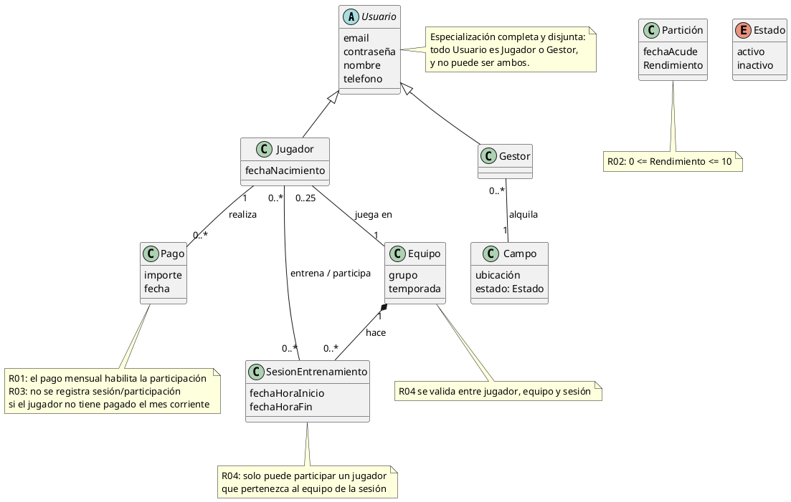
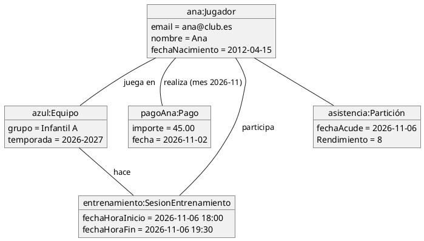
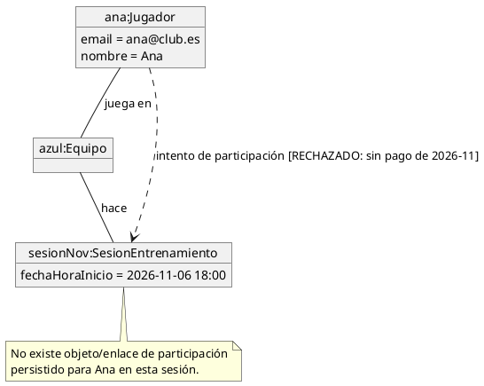
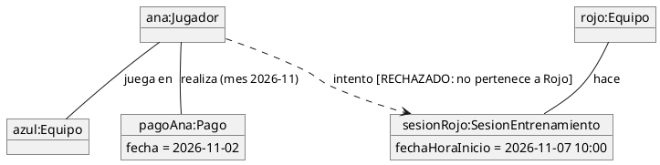
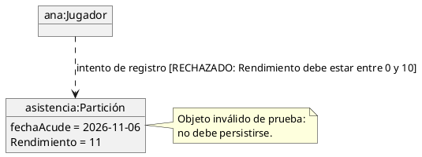

# ACADEMIA DE FÚTBOL "Gol & Formación"
 
## Miembros del grupo L6-DF-8 

1. Urbano Castro, Ignacio
2. Lorenzo Raposo, Daniel
3. Romero Gómez, Rafael
4. Camargo Moral, Julian

## 1. Introducción al problema

La Academia de Fútbol "Gol & Formación" ha experimentado un crecimiento en su volumen de alumnos durante los últimos años. Lo que comenzó como una pequeña escuela y equipo local ha evolucionado hasta convertirse en un reconocido club deportivo. En la actualidad, la institución centra su actividad exclusivamente en la vertiente formativa y deportiva.

Gestión Deportiva y Académica: Coordinación de equipos federados y de escuela en distintas categorías de edad (desde Prebenjamín hasta Juvenil), supervisión del cuerpo técnico, planificación de   sesiones de entrenamiento en pistas específicas y control de cuotas mensuales de los alumnos. 

## 2. Glosario de términos

Los términos específicos empleados en el dominio del problema son los siguientes:

* **Campo:** Instalación deportiva que el Gestor alquila para la realización de entrenamientos. El modelo conceptual solo recoge sus atributos `Item 1`, `Item 2` e `Item 3`.

* **Contrato:** Clase de asociación entre Equipo y Entrenador que registra `fechaInicio` y `fechaFin`. Su duración máxima es de un año.

* **Equipo:** Grupo deportivo identificado por `grupo` y `temporada`. Un equipo puede tener hasta 25 jugadores y se asocia con entrenadores mediante contratos.

* **Entrenador:** Persona identificada por `nombre`, `telefono` y `DNI`, vinculada a equipos mediante contratos. No hereda de Usuario.

* **Gestor:** Perfil derivado de Usuario, con los atributos `nombre` y `telefono`. Alquila campos.

* **Jugador:** Perfil derivado de Usuario, con los atributos `nombre`, `fechaNacimiento` y `telefono`. Realiza pagos, juega en equipos, asiste a sesiones de entrenamiento y puede ser entrenado por un Entrenador.

* **Pago:** Registro asociado a un Jugador que recoge `importe` y `fecha`. El pago mensual debe estar realizado para que el jugador participe en el entrenamiento.

* **Participación:** Clase de asociación entre Jugador y SesionEntrenamiento que registra `fechaAcude` y `Rendimiento`. El rendimiento debe estar entre 0 y 10.

* **SesionEntrenamiento:** Sesión con `fechaHoraInicio` y `fechaHoraFin`, relacionada con un equipo y con las participaciones de los jugadores.

* **Usuario:** Clase base con los atributos `email` y `contraseña`. La especialización en Jugador y Gestor es completa y disjunta: todo Usuario pertenece a uno de esos dos tipos.

## 3. Visión general del sistema

### 3.1. Requisitos generales

El sistema de gestión de la academia de fútbol administra usuarios, equipos, entrenamientos, pagos y campos deportivos. El modelo conceptual establece las siguientes relaciones y restricciones:

* **Gestión de usuarios:** Usuario se especializa en Jugador y Gestor mediante una jerarquía completa y disjunta. Ambos perfiles comparten las credenciales `email` y `contraseña`.

* **Control de pagos:** Cada Pago registra el `importe` y la `fecha`, y está asociado a un Jugador. El pago mensual debe estar realizado para que el jugador participe en los entrenamientos.

* **Gestión de equipos:** Equipo se identifica mediante `grupo` y `temporada`. Los jugadores juegan en equipos y cada equipo tiene un máximo de 25 jugadores.

* **Gestión de entrenamientos:** Las sesiones registran `fechaHoraInicio` y `fechaHoraFin`. La participación de cada jugador en una sesión se registra mediante la clase de asociación Participación, con `fechaAcude` y `Rendimiento`.

* **Gestión de entrenadores:** Los equipos se relacionan con los entrenadores mediante Contrato, que registra `fechaInicio` y `fechaFin`. Cada contrato puede durar como máximo un año.

* **Gestión de campos:** El Gestor alquila los campos deportivos, que el modelo identifica con los atributos `Item 1`, `Item 2` e `Item 3`.

* **Evaluación deportiva:** El rendimiento de cada jugador en una sesión debe estar entre 0 y 10.

### 3.2. Usuarios del sistema

El sistema distingue dos tipos de usuarios: Jugador y Gestor. Ambos heredan de Usuario, que almacena `email` y `contraseña`. La especialización es completa y disjunta, por lo que todo Usuario pertenece a uno de esos perfiles.

| **Tipo de actor** | **Rol / perfil** | **Descripción** |
| :--- | :--- | :--- |
| **Jugador** | Alumno de la academia | Tiene los atributos `nombre`, `fechaNacimiento` y `telefono`. Realiza pagos, juega en equipos y participa en sesiones de entrenamiento. |
| **Gestor** | Responsable administrativo | Tiene los atributos `nombre` y `telefono`. Se encarga de alquilar campos y gestionar la actividad de la academia. |

## 4. Catálogo de requisitos

### 4.1. Requisitos funcionales

### R.F.01. Registrar los pagos de un jugador

**Como** Gestor

**Quiero** registrar el importe y la fecha de los pagos de cada jugador

**Para** controlar el abono mensual de la academia.

**Prueba de aceptación**

* Registrar para cada Pago el `importe` y la `fecha`.
* Asociar cada pago con el Jugador correspondiente.
* Comprobar que el jugador ha realizado el pago mensual antes de permitirle participar en el entrenamiento.

---

### R.F.02. Gestionar los equipos y sus jugadores

**Como** Gestor

**Quiero** gestionar los equipos por grupo y temporada

**Para** organizar a los jugadores de la academia.

**Prueba de aceptación**

* Registrar el `grupo` y la `temporada` de cada Equipo.
* Asociar los jugadores con sus equipos.
* Comprobar que un equipo no supere el máximo de 25 jugadores.

---

### R.F.03. Registrar sesiones y participaciones

**Como** Gestor

**Quiero** registrar las sesiones de entrenamiento y la participación de cada jugador

**Para** llevar el control de la asistencia y del rendimiento deportivo.

**Prueba de aceptación**

* Registrar para cada sesión la `fechaHoraInicio` y la `fechaHoraFin`.
* Asociar las sesiones con los equipos correspondientes.
* Registrar la participación de cada Jugador en cada sesión mediante la clase de asociación Participación.
* Guardar en cada Participación la `fechaAcude` y el `Rendimiento`.
* Validar que el `Rendimiento` esté entre 0 y 10.
* Comprobar que el jugador haya realizado el pago mensual antes de participar.

---

### R.F.04. Gestionar los contratos de los entrenadores

**Como** Gestor

**Quiero** registrar los contratos entre equipos y entrenadores

**Para** dejar constancia de la vinculación y de su duración.

**Prueba de aceptación**

* Asociar cada Contrato con un Equipo y un Entrenador.
* Guardar la `fechaInicio` y la `fechaFin` del contrato.
* Comprobar que la duración del contrato no supere un año.

---

### R.F.05. Alquilar campos deportivos

**Como** Gestor

**Quiero** alquilar campos deportivos

**Para** disponer de instalaciones para la actividad de la academia.

**Prueba de aceptación**

* Asociar los campos alquilados con el Gestor.
* Registrar y consultar los tres atributos del Campo (`Item 1`, `Item 2` e `Item 3`), cuyos nombres aparecen así en el modelo conceptual.

---

## 4.1.1. Requisitos de información

#### R.I.01. Datos de usuario

**Como** Gestor

**Quiero** guardar las credenciales de los usuarios

**Para** que puedan identificarse en el sistema.

**Prueba de aceptación**

* Guardar el `email` y la `contraseña` de cada Usuario.
* Comprobar que Usuario se especializa en Jugador y Gestor mediante una jerarquía completa y disjunta.

---

#### R.I.02. Datos del jugador

**Como** Gestor

**Quiero** guardar los datos de los jugadores

**Para** gestionar su participación en la academia.

**Prueba de aceptación**

* Guardar el `nombre`, la `fechaNacimiento` y el `telefono`.
* Incluir las credenciales heredadas de Usuario.
* Asociar al jugador con sus pagos, equipos y participaciones en sesiones.

---

#### R.I.03. Datos del gestor

**Como** Gestor

**Quiero** guardar mis datos de perfil

**Para** realizar las gestiones de la academia.

**Prueba de aceptación**

* Guardar el `nombre` y el `telefono`.
* Incluir las credenciales heredadas de Usuario.
* Asociar al Gestor con los campos que alquila.

---

#### R.I.04. Datos del equipo

**Como** Gestor

**Quiero** guardar la información de los equipos

**Para** organizarlos por grupo y temporada.

**Prueba de aceptación**

* Guardar el `grupo` y la `temporada`.
* Asociar el Equipo con sus jugadores.
* Asociar el Equipo con sus entrenadores mediante Contrato.
* Respetar el máximo de 25 jugadores por equipo.

---

#### R.I.05. Datos del entrenador

**Como** Gestor

**Quiero** guardar la información de los entrenadores

**Para** asociarlos con los equipos mediante contratos.

**Prueba de aceptación**

* Guardar el `nombre`, el `telefono` y el `DNI`.
* Asociar al Entrenador con los equipos mediante Contrato.
* Comprobar que Entrenador no hereda de Usuario ni dispone de credenciales de acceso según el modelo conceptual.

---

#### R.I.06. Datos del contrato

**Como** Gestor

**Quiero** guardar los datos de los contratos

**Para** registrar la relación entre entrenadores y equipos.

**Prueba de aceptación**

* Guardar `fechaInicio` y `fechaFin`.
* Asociar cada Contrato con un Equipo y un Entrenador.
* Comprobar que el contrato no dure más de un año.

---

#### R.I.07. Datos de la sesión de entrenamiento

**Como** Gestor

**Quiero** guardar los datos de las sesiones

**Para** organizar los entrenamientos de los equipos.

**Prueba de aceptación**

* Guardar `fechaHoraInicio` y `fechaHoraFin`.
* Asociar las sesiones con los equipos.
* Registrar las participaciones de los jugadores en cada sesión.

---

#### R.I.08. Datos de participación y rendimiento

**Como** Gestor

**Quiero** guardar la asistencia y el rendimiento de cada jugador en las sesiones

**Para** consultar su actividad deportiva.

**Prueba de aceptación**

* Guardar `fechaAcude` y `Rendimiento` en la clase de asociación Participación.
* Asociar cada Participación con un Jugador y una SesionEntrenamiento.
* Validar que `Rendimiento` esté entre 0 y 10.

---

#### R.I.09. Datos del pago

**Como** Gestor

**Quiero** guardar los datos de los pagos de los jugadores

**Para** controlar el abono mensual.

**Prueba de aceptación**

* Guardar `importe` y `fecha`.
* Asociar cada Pago con el Jugador correspondiente.
* Comprobar que el pago mensual esté realizado antes de la participación del jugador en el entrenamiento.

---

#### R.I.10. Datos del campo

**Como** Gestor

**Quiero** guardar los datos de los campos deportivos

**Para** gestionar su alquiler.

**Prueba de aceptación**

* Asociar cada Campo con el Gestor que lo alquila.
* Registrar y consultar los atributos `Item 1`, `Item 2` e `Item 3`, tal como aparecen en el modelo conceptual.

---

### 4.1.2. Reglas de negocio

#### R.N.01. Pago mensual para participar

El pago mensual debe estar realizado para que un Jugador participe en el entrenamiento.

#### R.N.02. Máximo de jugadores por equipo

Un Equipo tendrá un máximo de 25 jugadores.

#### R.N.03. Duración máxima del contrato

Cada Contrato tendrá una duración máxima de un año.

#### R.N.04. Rango del rendimiento

El valor de `Rendimiento` registrado en una Participación debe estar entre 0 y 10.

---

## 4.2. Mapa de historias de usuario (opcional)

| ID Historia | Rol / Actor | Servicio / Acción | Requisito relacionado | Regla de negocio |
| :--- | :--- | :--- | :--- | :--- |
| **HU-01** | Gestor | Registrar y consultar los pagos de los jugadores | R.F.01 | R.N.01 |
| **HU-02** | Gestor | Organizar equipos y jugadores por grupo y temporada | R.F.02 | R.N.02 |
| **HU-03** | Gestor | Registrar sesiones, asistencias y rendimiento | R.F.03 | R.N.01, R.N.04 |
| **HU-04** | Gestor | Registrar contratos de entrenadores y equipos | R.F.04 | R.N.03 |
| **HU-05** | Gestor | Gestionar el alquiler de campos deportivos | R.F.05 | - |

## 4.3. Requisitos no funcionales (opcional)

### R.N.F. 01. Guardar contraseñas de forma segura
Como Jugador / Gestor quiero que mi clave se guarde encriptada en la base de datos para que nadie pueda robármela.

### R.N.F. 02. Control automático de fallos en los datos
Como Gestor quiero que el sistema me avise o me bloquee si pongo mal una nota o un contrato para no guardar datos incorrectos por descuido.

-- fin entregable 1 --

#5. Modelo conceptual y 6. Matriz de trazabilidad

## Base y alcance

Este apartado se ha elaborado a partir de `modelo_conceptual_club_1.drawio`. El diagrama presenta las clases `Usuario`, `Jugador`, `Gestor`, `Equipo`, `Pago`, `SesionEntrenamiento`, `Partición` y el enumerado `Estado`. Las reglas anotadas en el modelo son R01–R04. No se adjuntó un catálogo independiente de requisitos RI/RF/RN, así que la matriz usa las reglas del propio diagrama como filas y no atribuye requisitos inventados.

## 5.1. Diagrama de clases UML con restricciones

El siguiente PlantUML normaliza el modelo para que se pueda generar como diagrama. La multiplicidad de `Jugador–Equipo` aparece como `25` y `*` en el dibujo, pero su ubicación no queda inequívoca al extraer el archivo; se interpreta aquí como un máximo de 25 jugadores por equipo y un equipo por jugador. Conviene confirmar esta decisión con el autor del modelo.

**Restricciones de negocio expresadas en el modelo**

- **R01 – Pago para participar:** el jugador debe realizar el pago mensual correspondiente para poder participar en entrenamientos.
- **R02 – Rango de rendimiento:** `Partición.Rendimiento` debe estar en el intervalo cerrado `[0, 10]`.
- **R03 – Pago corriente:** no se registra una participación/sesión para el jugador si no consta el pago del mes corriente. El texto del diagrama dice «introducir una sesión»; se interpreta como registrar la participación del jugador en ella, dado que la sesión es una entidad asociada al equipo.
- **R04 – Pertenencia al equipo:** un jugador solo puede participar en sesiones del equipo al que pertenece.
- **Especialización:** `Usuario` se divide en `Jugador` y `Gestor` con conjunto completo y disjunto, tal como indica `{completa, disjunta}`.
- **Estado de campo:** solo puede tomar los valores `activo` o `inactivo`.
- **Multiplicidades:** se han reflejado las asociaciones y multiplicidades legibles en el dibujo. La interpretación de `25` requiere confirmación como máximo de jugadores por equipo.

## 5.2. Escenarios de prueba

Los diagramas de objetos siguientes usan sintaxis PlantUML. Los casos negativos describen operaciones rechazadas; los enlaces punteados representan el intento que se valida, no una relación persistida tras el rechazo.

### EP-01 – Participación válida con pago corriente

**Descripción.** Dado un jugador asignado al equipo Azul, con pago de noviembre registrado, se intenta incorporarlo a una sesión de noviembre de ese equipo. La operación se acepta y se registra su participación. Verifica R01, R03 y R04.

### EP-02 – Rechazo por falta de pago corriente

**Descripción.** Dado un jugador del equipo Azul sin pago registrado para noviembre, se intenta registrar su participación en una sesión de noviembre. La operación se rechaza y no se crea el enlace de participación. Verifica R01 y R03.

### EP-03 – Rechazo por equipo distinto

**Descripción.** Dado que Ana pertenece al equipo Azul y la sesión la organiza el equipo Rojo, se intenta registrar a Ana en esa sesión. La operación se rechaza aunque tenga pago al día. Verifica R04.

### EP-04 – Rechazo de rendimiento fuera de rango

**Descripción.** Al guardar una participación con `Rendimiento = 11`, la validación la rechaza porque el valor supera 10. Verifica R02.

## 6. Matriz de trazabilidad

Para esta matriz, las columnas agrupan clases/entidades, asociaciones y restricciones identificadas en el modelo. `X` indica que el elemento participa en la regla. `Usuario` se incluye en la trazabilidad de identidad y especialización; los requisitos del club se relacionan con `Jugador`, no con `Gestor`.

| Regla del modelo | Usuario / especialización | Jugador | Equipo | Pago | Sesión | Partición | Asociación juega en | Asociación hace | Asociación entrena | Asociación realiza | R01 pago mensual | R02 rango 0–10 | R03 pago corriente | R04 pertenencia |
|:--|:--:|:--:|:--:|:--:|:--:|:--:|:--:|:--:|:--:|:--:|:--:|:--:|:--:|:--:|
| R01 – Pago mensual habilita participación |  | X |  | X | X |  |  |  | X | X | X |  |  |  |
| R02 – Rendimiento entre 0 y 10 |  | X |  |  |  | X |  |  |  |  |  | X |  |  |
| R03 – Sin pago corriente no se registra participación/sesión |  | X |  | X | X |  |  |  | X | X |  |  | X |  |
| R04 – Solo participa en sesiones del equipo al que pertenece |  | X | X |  | X |  | X | X | X |  |  |  |  | X |
| Especialización completa y disjunta | X | X |  |  |  |  |  |  |  |  |  |  |  |  |

### Cómo completar la matriz RI/RF/RN solicitada

El ejemplo de la solicitud usa requisitos `RI-*`, `RF-*` y `RN-*`, pero el archivo adjunto no contiene sus definiciones. Para sustituir las filas `R01–R04` por las filas definitivas y trazar todos los requisitos, hace falta el documento/listado de requisitos. En particular, no hay base en este modelo para atribuir requisitos de interfaz (`RI`), funcionales adicionales (`RF`) ni no funcionales (`RN`).

-- fin entregable 2 --

## 7. Modelo relacional en 3FN

- Relaciones obtenidas al aplicar la transformación del modelo conceptual.

### 7.1.  Justificación de la estrategia de transformación de jerarquías

- si se identificaron jerarquías en el MC.

### 8. Matriz de trazabilidad MC/SQL (opcional):

- Restricciones sobre el MC / Elementos del modelo tecnológico (SQL) (Triggers, checks, etc.)
- Incluir Reglas de negocio — Constraints/Triggers en las matrices de trazabilidad para el entregable 3

|       | EntidadX   | AsociaciónX  | RestricciónX  | Entidad2 ...   | 
|:-------|:-------|:-------|:-------|:-------|
| TABLA-1 |        |        |        |        |
| TABLA-2 |        |        |        |        |
| TABLA-3 |        |        |        |        |
| TABLA-4 |        |        |        |        |
| TRIG-1 |        |        |        |        |
| TRIG-2 | X      | X      |        | X      |
| TRIG-3 |        | X      |        | X      |
| TRIG-4 |        |        | X      |        |
| CONST-1 |        |        |        |        |
| CONST-2 | X      | X      |        | X      |
| CONST-3 |        | X      |        | X      |
| CONST-4 |        |        | X      |        |

Se consideran todo tipo de constraints declarativas (aquellas definidas durante el CREATE TABLE).
-- fin entregable 3 --

## Referencias

